# Umbral

Panel web para administrar tu servidor Linux doméstico y tu red desde el navegador, en el ordenador o en el móvil. Está en español y tiene un diseño inspirado en Apple.

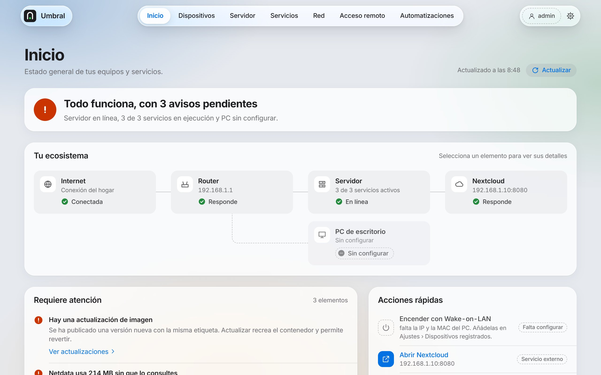

Es un único programa de unos 9 MB que gasta alrededor de 15 MB de RAM. No usa base de datos ni servicios extra: guarda su estado en archivos JSON en `/var/lib/umbral`. Lo que no exista en tu servidor (Nextcloud, Tailscale, sensor de temperatura, router con API…) simplemente no aparece.

## Qué hace

- **Docker**:
  - contenedores e imágenes;
  - un asistente de despliegue desde el catálogo, una imagen o Docker Compose;
  - el registro de cada contenedor;
  - límite de memoria por servicio;
  - limpieza de la caché de compilación y de los volúmenes sin usar;
  - actualizaciones con vuelta atrás. Las de Nextcloud son seguras: modo de mantenimiento y copia previa de la base de datos;
  - el salto a la siguiente versión mayor de Nextcloud, guiado y con las mismas precauciones.
- **Disponibilidad**: el porcentaje de tiempo que cada servicio estuvo funcionando en 24 horas y 7 días, y sus caídas.
- **Servidor**:
  - CPU, memoria, discos, red y temperatura, en vivo (cada 2 s) o con historial de 1 hora, 24 horas y 7 días;
  - salud de los discos (SMART);
  - actualizaciones pendientes de Debian, marcando las de seguridad.
- **Copias de seguridad**:
  - copia completa de Nextcloud (base de datos y archivos) a un disco USB, en instantáneas que solo ocupan lo que cambia;
  - las copias se pueden descargar desde el panel;
  - se hacen a mano o cada noche, con aviso al móvil si fallan.
- **Red**:
  - los dispositivos conectados, con su nombre, fabricante y estado;
  - con un router OpenWrt o MikroTik: nombres del DHCP, quitar Internet a un equipo y reiniciar el router.
- **PC**: encenderlo con Wake-on-LAN y abrir el escritorio remoto (RDP, RustDesk o Moonlight).
- **Acceso remoto**: publicar el panel o cualquier servicio con HTTPS en tu red Tailscale, con un clic.
- **Automatizaciones**: «cuando pase esto, si se cumple esto, haz esto».
  - Se lanzan desde un horario, un servicio que se cae, un umbral de recursos, la llegada o salida de un dispositivo, un acceso al panel, o un atajo del iPhone o una etiqueta NFC.
  - Pueden avisarte al móvil con ntfy.
- **App en el móvil**: se instala en la pantalla de inicio del iPhone o Android y se abre a pantalla completa.
- **Seguridad**:
  - solo accesible desde tu red local y Tailscale;
  - contraseña y verificación en dos pasos (TOTP) opcional;
  - registro de accesos.

## Capturas

| | |
|---|---|
| 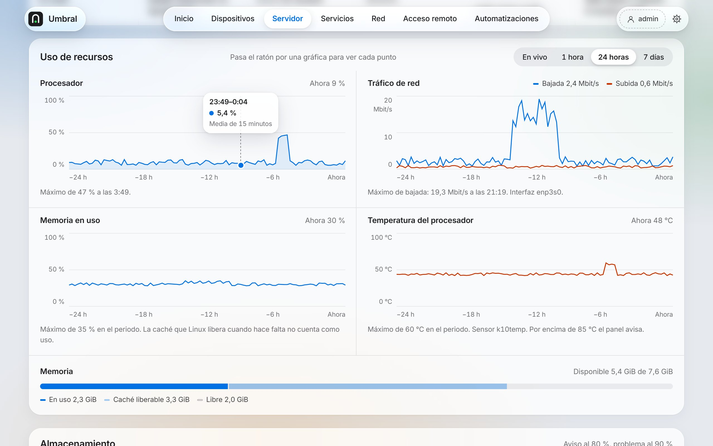 | 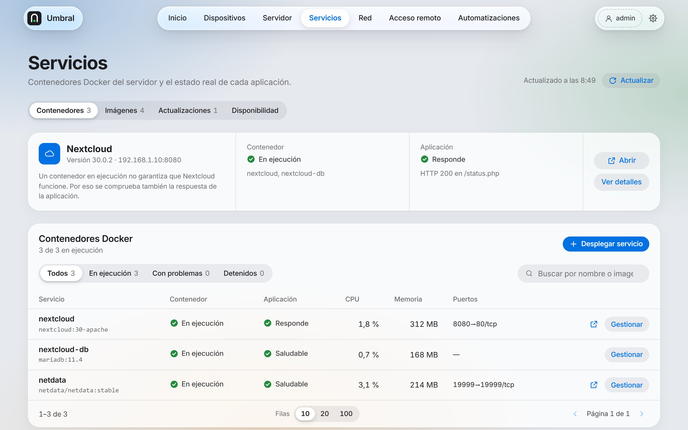 |
| **Servidor**: métricas con lectura de cada punto | **Servicios**: contenedores, imágenes y actualizaciones |
| 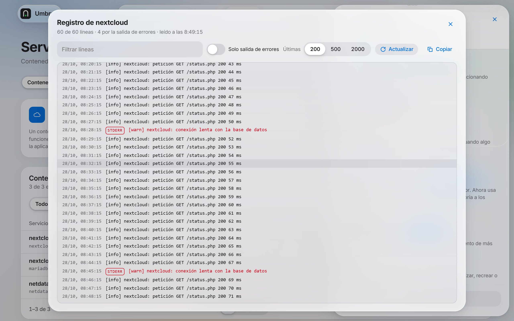 | 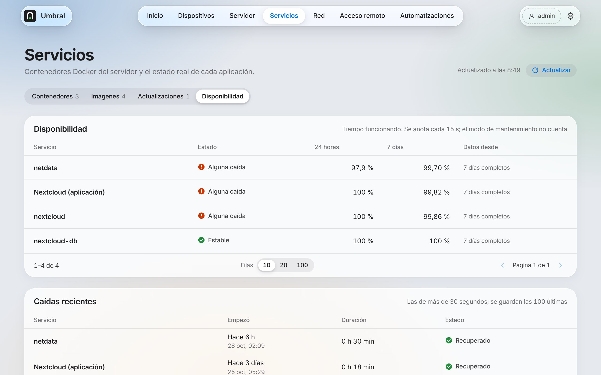 |
| **Registro** de un contenedor | **Disponibilidad** y caídas |
| 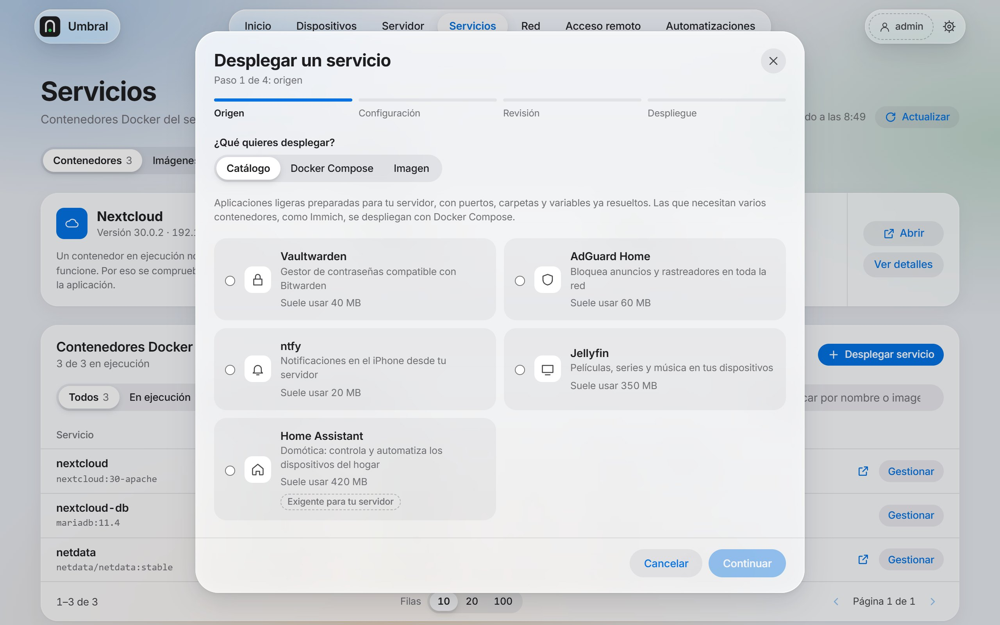 | 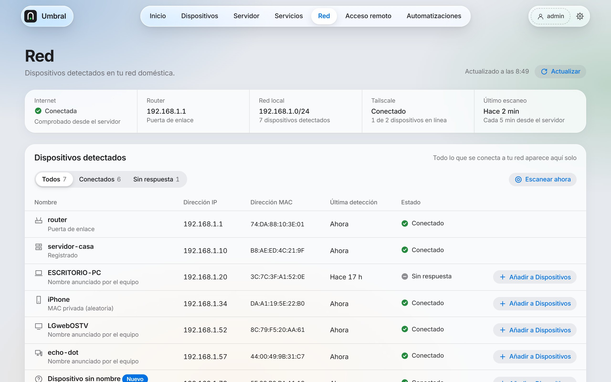 |
| **Asistente de despliegue** | **Red**: dispositivos detectados |
| 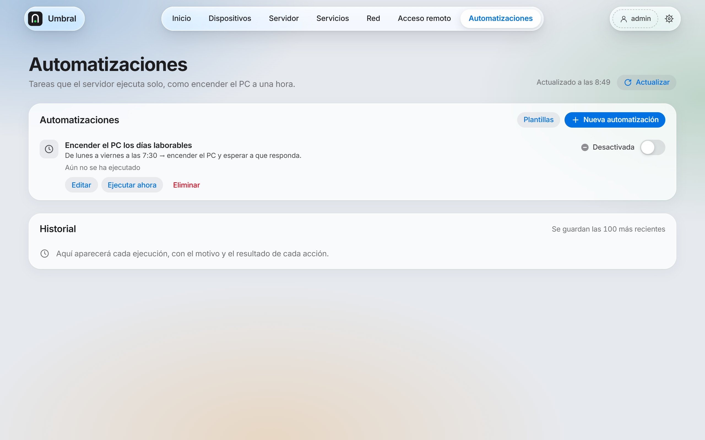 | 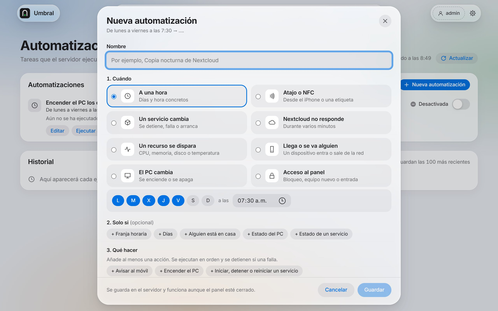 |
| **Automatizaciones** | **Editor de reglas** |
| 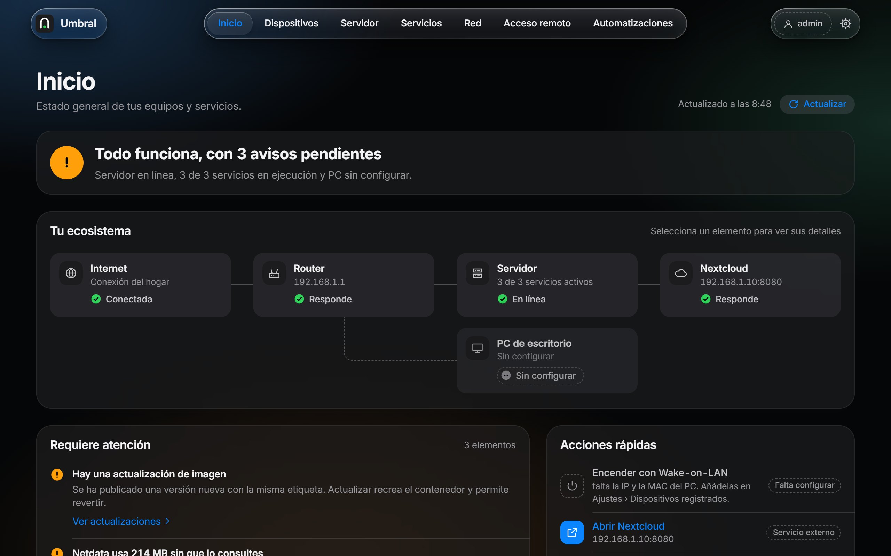 | 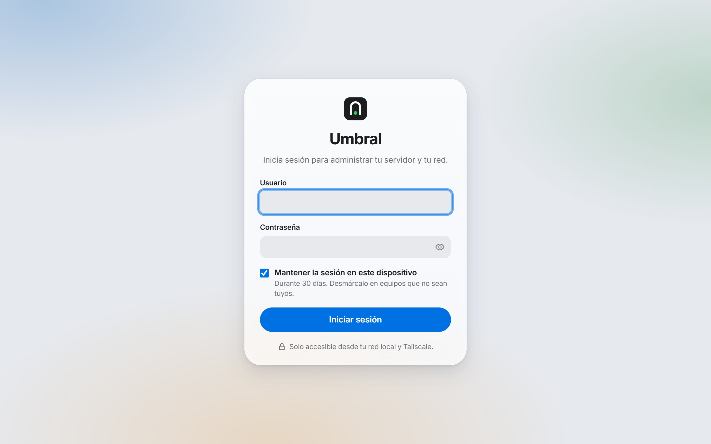 |
| **Modo oscuro** | **Inicio de sesión** |

<p>
  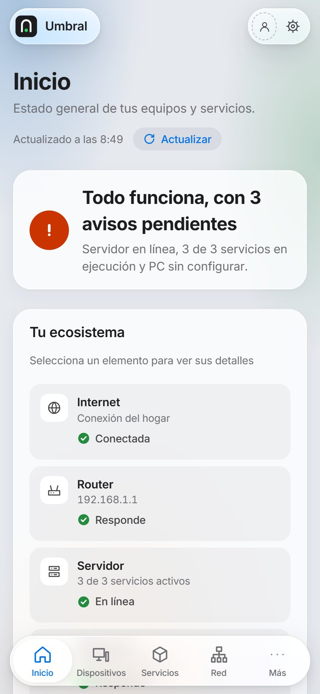
  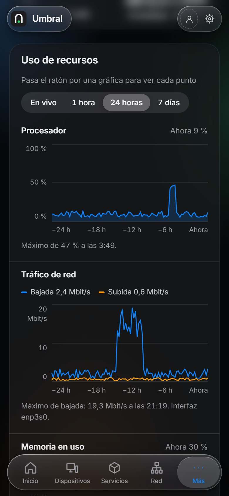
</p>

Las capturas usan el servidor simulado de desarrollo, con datos de ejemplo.

## Requisitos

- Linux con systemd (probado en Debian 12 y 13), en amd64 o arm64 (por ejemplo, una Raspberry Pi 4 o 5).
- Docker, si quieres gestionar contenedores.
- Opcional:
  - [Tailscale](https://tailscale.com), para entrar desde fuera de casa;
  - `smartmontools`, para la salud de los discos.

## 1. Instalar

### Con una versión publicada (recomendado)

En la página **Releases** del repositorio, descarga el paquete de tu arquitectura (`umbral-X.Y.Z-linux-amd64.tar.gz` o `…-arm64.tar.gz`). En el servidor:

```sh
tar -xzf umbral-*-linux-*.tar.gz
cd umbral-*-linux-*
sudo sh instalar.sh
```

### Compilando tú

Necesitas Node.js 20 o superior y Go 1.27 o superior. Puedes compilar en tu ordenador y copiar el resultado al servidor.

```sh
git clone <este-repositorio> umbral && cd umbral
npm install
npm run build                       # compila el panel en server/web/dist
cd server
go test ./...
GOOS=linux GOARCH=amd64 CGO_ENABLED=0 go build -trimpath -ldflags "-s -w" -o ../dist/umbral-linux-amd64 .
```

Usa `GOARCH=arm64` y el nombre `umbral-linux-arm64` para una Raspberry Pi. Después copia al servidor, a una misma carpeta, el binario y los archivos de `deploy/`, y ejecuta `sudo sh instalar.sh` desde ella:

```sh
ssh USUARIO@SERVIDOR mkdir -p umbral
scp dist/umbral-linux-amd64 deploy/* USUARIO@SERVIDOR:umbral/
ssh -t USUARIO@SERVIDOR "cd umbral && sudo sh instalar.sh"
```

### Qué hace el instalador

- crea el usuario de sistema `umbral` y lo añade al grupo `docker`;
- copia el binario a `/usr/local/bin/umbral`;
- crea `/var/lib/umbral` (configuración y estado) y `/srv/umbral` (datos de lo que despliegues);
- instala y arranca el servicio `umbral`;
- instala el **ayudante de sistema** (`umbral-sistema`): lee la salud de los discos y la lista de paquetes de Debian cada 6 horas, o cuando pulsas «Comprobar ahora». Es lo único que corre como root, y no recibe datos del panel;
- si hay Tailscale, da permiso al usuario `umbral` para publicar servicios con HTTPS.

## 2. Crear tu usuario

La contraseña debe tener al menos 10 caracteres:

```sh
sudo -u umbral umbral usuario crear TU-NOMBRE -datos /var/lib/umbral
```

Abre `http://IP-DEL-SERVIDOR:8420` desde tu red local.

## 3. Primeros pasos en el panel

1. **Ajustes › Seguridad y acceso**: activa la verificación en dos pasos.
2. **Acceso remoto › Publicar con HTTPS en Tailscale**: publica Umbral. Así entras por `https://<servidor>.<tu-red>.ts.net` en casa y fuera.
3. **Ajustes › Avisos**: configura ntfy para recibir avisos en el móvil.
4. **Ajustes › Dispositivos registrados**: elige tu PC entre los equipos detectados para poder encenderlo.
5. **Red**: pon nombre a los dispositivos que no lo anuncian y añade a **Dispositivos** los que quieras seguir.
6. **Automatizaciones**: empieza con una plantilla, como «Avisarme si un servicio se cae» o «Copia nocturna de Nextcloud».
7. **Servidor › Copias de seguridad**: conecta un disco USB formateado en ext4, elige su carpeta y haz la primera copia completa de Nextcloud. Paso a paso en [docs/copias-de-seguridad.md](docs/copias-de-seguridad.md).
8. Si tienes un router OpenWrt o MikroTik, configúralo en **Ajustes › Integraciones › Router**.

## Dónde guarda los datos

| Ruta | Contenido |
|---|---|
| `/var/lib/umbral/` | Configuración, usuarios (contraseñas con hash), sesiones, historiales, accesos, métricas, disponibilidad, dispositivos y automatizaciones, en archivos JSON con permisos `0600`. |
| `/var/lib/umbral/secrets/` | Secretos de los despliegues, del router y de los avisos. El panel nunca los muestra. |
| `/var/lib/umbral-helper/` | Lo que escribe el ayudante de sistema (SMART y lista de paquetes). Umbral solo lo lee. |
| `/srv/umbral/` | Datos de los servicios desplegados desde el panel. |
| `/srv/umbral/copias/` | Copias de la base de datos de Nextcloud previas a cada actualización (las 5 últimas). |
| `<disco externo>/nextcloud-archivos/` | Instantáneas de los archivos de Nextcloud, si eliges una carpeta externa (las 7 últimas). |

Para hacer una copia de seguridad de Umbral basta con copiar `/var/lib/umbral`.

## Mantenimiento

| Para… | Orden |
|---|---|
| Ver los registros | `journalctl -u umbral -f` |
| Cambiar una contraseña | Desde **Ajustes**, o `sudo -u umbral umbral usuario crear NOMBRE -datos /var/lib/umbral` |
| Ver los usuarios | `sudo -u umbral umbral usuario lista -datos /var/lib/umbral` |
| Quitar el doble factor (móvil perdido) | `sudo -u umbral umbral usuario quitar-2fa NOMBRE -datos /var/lib/umbral` |
| Actualizar Umbral | Descarga la versión nueva y vuelve a ejecutar `sudo sh instalar.sh`. Los datos se conservan. |
| Desinstalar | `sudo systemctl disable --now umbral umbral-sistema.timer umbral-sistema.path && sudo rm /etc/systemd/system/umbral*.service /etc/systemd/system/umbral-sistema.* /usr/local/bin/umbral` (y, si quieres, `/var/lib/umbral` y `/var/lib/umbral-helper`) |

La configuración avanzada está en `/var/lib/umbral/config.json`:
- `listen`: puerto, por defecto `:8420`.
- `allowNets`: redes que pueden abrir el panel.
- `dockerSocket`: ruta del socket de Docker.

Lo demás se configura desde el panel.

## Desarrollo

```sh
npm install
echo VITE_UMBRAL_PRUEBAS=1 > .env.development.local
npm run dev                         # http://localhost:5173, con un servidor simulado
```

- El servidor simulado acepta cualquier usuario con una contraseña de al menos 4 caracteres.
- Añade `?mantenimiento` o `?sinservidor` a la URL para probar esos estados.
- Solo existe en desarrollo: no entra en la compilación.

**Integración continua:**
- Cada cambio pasa las pruebas del panel y del servicio para amd64 y arm64 (`.github/workflows/pruebas.yml`).
- Al subir una etiqueta, se publica una versión con los paquetes listos para instalar (`publicar.yml`):

  ```sh
  git tag v1.2.0 && git push origin v1.2.0
  ```

**Documentación:**
- `docs/arquitectura.md`: cómo funciona el servicio, qué lee y cada cuánto, y su modelo de seguridad.
- `docs/copias-de-seguridad.md`: preparar el disco externo, programar las copias de Nextcloud y restaurarlas.
- `docs/sistema-de-diseno.md`: el diseño.

## Licencia

MIT. Consulta [LICENSE](LICENSE).
